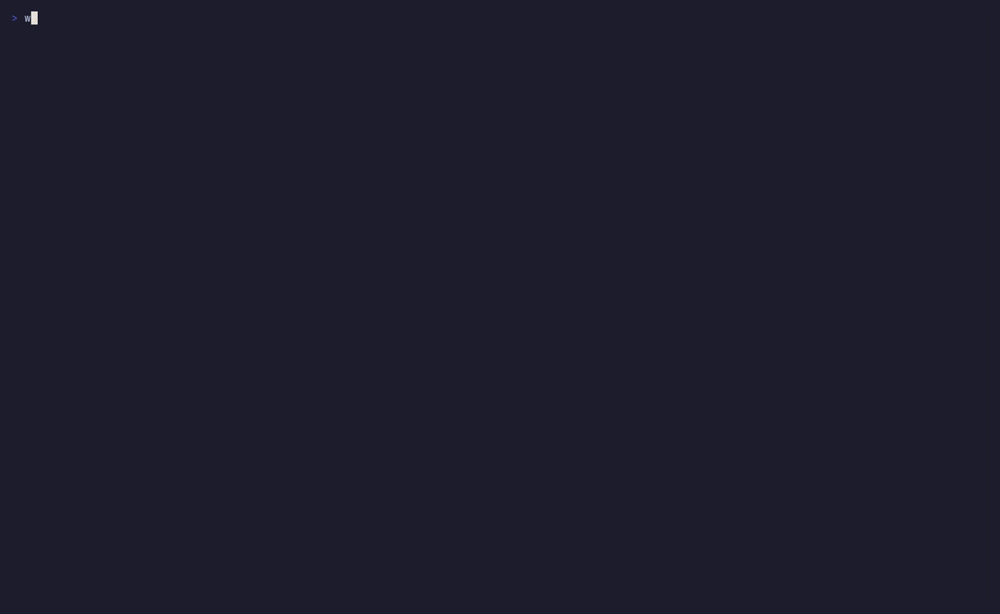

# worlds-tui

A terminal app for following the League of Legends World Championship: live
game stats and a viewer for the Play-In, Swiss Stage and Knockouts.

Built with Go and [Bubble Tea](https://github.com/charmbracelet/bubbletea).



## Install

Download a release from the
[releases page](https://github.com/BigBoyChnusti/worlds-tui/releases).
Builds exist for x86_64 (`amd64`), 64-bit ARM (`arm64`, e.g. Raspberry Pi
4/5 with a 64-bit OS, Apple Silicon, Windows on ARM) and 32-bit ARMv7 on
Linux (`armhf`/`armv7hl`/`armv7`, e.g. Raspberry Pi OS 32-bit):

| System | File | Install |
|---|---|---|
| Debian, Ubuntu, Raspberry Pi OS | `worlds-tui_<version>_<amd64\|arm64\|armhf>.deb` | `sudo apt install ./worlds-tui_<version>_<arch>.deb` |
| Fedora, RHEL, openSUSE | `worlds-tui-<version>-1.<x86_64\|aarch64\|armv7hl>.rpm` | `sudo dnf install ./worlds-tui-<version>-1.<arch>.rpm` |
| Any Linux | `worlds-tui_<version>_linux_<amd64\|arm64\|armv7>` | `chmod +x` it and run it |
| macOS | `worlds-tui_<version>_darwin_<amd64\|arm64>` | `chmod +x` it and run it |
| Windows | `worlds-tui_<version>_windows_<amd64\|arm64>.exe` | Run it in Windows Terminal |

`checksums.txt` lists the SHA-256 of every file.

With Go installed you can also run
`go install github.com/BigBoyChnusti/worlds-tui/cmd/worlds-tui@latest`, or
`go run ./cmd/worlds-tui` from a checkout.

## Run

```sh
worlds-tui
```

| Flag | Default | |
|---|---|---|
| `-tournament` | current | Tournament slug, e.g. `worlds_2025` |
| `-game` | | Open a game id on start, e.g. to replay a finished game |
| `-refresh` | `2s` | Minimum time between live stats requests |
| `-data-refresh` | `1m` | Standings and schedule refresh interval |
| `-version` | | Print the version and exit |
| `-snapshot` | | Print the menu and every view once and exit (`-width` and `-height` set the size) |

Try a finished game: `worlds-tui -tournament worlds_2025 -game 113475798006664579`
(with `-game` the app skips the menu and opens the game directly).

## Views and keys

The app opens on a main menu with the logo, the Summoner's Cup and a status
line for each section (live match or next match countdown, stage
progress). Pick a section with the arrow keys and `enter`, or press its
number. The trophy and block logo are left out when the terminal is too
small for them.

| Key | |
|---|---|
| `tab`, `shift+tab` | Next/previous view |
| `1`–`5` | Jump to Live · Play-In · Swiss · Knockouts · Schedule |
| `esc`, `m` | Back to the main menu |
| `↑`/`↓`, `j`/`k` | Select a match (bracket tabs) or scroll (Live) |
| `enter` | Open the selected match on the Live tab |
| `←`/`→`, `[`/`]` | Previous/next game of the series on the Live tab |
| `n` | Next live match |
| `f` | Follow the live match again after opening another one |
| `r` | Refresh now |
| `q` | Quit |

The mouse works too: click a tab, a menu entry, a game of the open series
or any match in the bracket and schedule views, and scroll with the wheel.
Hold `shift` while dragging to select text in most terminals.

- **Live**: series score, game clock, team kills, gold, towers,
  inhibitors, barons and dragons, a gold-lead graph, and a 5v5 table with
  K/D/A, CS, gold, lane gold difference, level, kill participation, damage
  share and item builds. It follows the first live Worlds match on its own;
  between matches it shows a countdown to the next one.
- **Play-In**: the four-team double-elimination bracket.
- **Swiss**: all five rounds grouped by the record teams carried into each
  match, plus standings with advanced and eliminated teams.
- **Knockouts**: quarterfinals, semifinals and final.
- **Schedule**: every match by day, in local time.

## Data sources

There is no official public API for pro games; the Riot developer API only
covers ranked and normal games. The app uses the same undocumented
endpoints as [lolesports.com](https://lolesports.com):

| Source | Used for |
|---|---|
| `esports-api.lolesports.com/persisted/gw` (`getLive`, `getSchedule`, `getStandings`, `getEventDetails`, `getTournamentsForLeague`) with the public `x-api-key` from the site | Live matches, schedule, stages and results, games of a match |
| `feed.lolesports.com/livestats/v1/window/{gameId}` | Team gold, kills, towers, inhibitors, barons and dragons, and per-player K/D/A, CS, gold and level, in 10-second windows of frames |
| `feed.lolesports.com/livestats/v1/details/{gameId}` | Items, runes, kill participation, damage share, wards |
| [Data Dragon](https://developer.riotgames.com/docs/lol#data-dragon) | Item and champion names, cached in the user cache directory |

Things the feed doesn't provide and the app derives:

- **Game clock**: time since the game's first frame, minus pauses. The app
  fetches each 10-second feed window as soon as it exists and replays its
  frames in real time, so the clock ticks every second and kills, gold and
  objectives change when they happened, about a minute behind the
  broadcast.
- **Gold leads**: blue minus red team gold, and per lane by role.
- **Bracket structure**: the gateway's `previousMatchIds` are empty, so
  stages are laid out from schedule order and block names. Swiss records
  are computed from completed matches.

Caveats:

- The endpoints are undocumented and can change without notice.
- `startingTime` must be a multiple of 10 seconds, and the feed has no
  frames for roughly the last minute, so live stats run about a minute
  behind real time.
- The gateway marks a game as in progress before the feed has data for it
  (during the draft), and the feed has been seen returning nothing for a
  running game for over 20 minutes before catching up. The Live tab says
  so and keeps retrying.
- The gateway's per-game `side` field has been seen swapped; team sides
  come from the feed's `esportsTeamId` instead.

## Development

```sh
go test ./...
go vet ./...
```

Tests run against API responses saved in `internal/*/testdata` (Worlds 2025
and 2026), so they don't need the network.

The demo GIF is recorded with [VHS](https://github.com/charmbracelet/vhs)
from `demo/demo.tape`. It runs against the live API, so the Live tab shows
whatever match is on at the time:

```sh
vhs demo/demo.tape
```

## CI and releases

GitHub Actions runs two workflows:

- **CI** (`.github/workflows/ci.yml`), on every push to `main` and every
  pull request: gofmt check, `go vet` and `go test -race` on both an
  x86_64 and an arm64 runner, then a GoReleaser snapshot build of every
  target. The snapshot's binaries, `.deb` and `.rpm` files are kept as a
  workflow artifact for 14 days, and a smoke job installs the `amd64` and
  `arm64` `.deb` on native runners and starts the installed binary.
- **Release** (`.github/workflows/release.yml`), on a `v*` tag: runs the
  tests, then [GoReleaser](https://goreleaser.com) builds everything in
  `.goreleaser.yaml` and publishes a GitHub release with a changelog
  grouped by commit type.

To cut a release:

```sh
git tag -a v0.1.0 -m "v0.1.0"
git push origin v0.1.0
```

Build the same files locally with `goreleaser release --snapshot --clean`;
they land in `dist/`.

## License

Copyright 2026 BigBoyChnusti

Licensed under the [Apache License, Version 2.0](LICENSE).

League of Legends and Worlds are trademarks of Riot Games, Inc. This
project is not endorsed by or affiliated with Riot Games.
